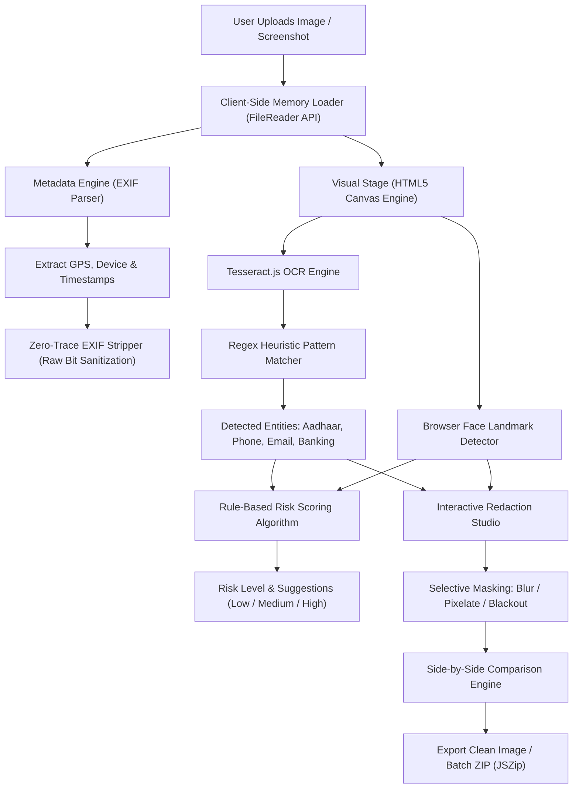

# Privacy Lens: Intelligent Client-Side Image Privacy Protection & Redaction System
## Comprehensive Technical Project Documentation & System Specifications

---

## 1. Abstract

In today's digital era, the widespread sharing of screenshots, scanned documents, identity cards, transaction receipts, and personal photos across social media and messaging platforms frequently leads to inadvertent disclosure of Personally Identifiable Information (PII). Unintentional exposure of confidential data—such as phone numbers, email addresses, Aadhaar / national identity numbers, credit card / bank credentials, facial identities, and embedded GPS metadata—presents severe privacy risks, identity theft, financial fraud, and cyber harassment. Traditional manual editing methods (such as scribbling with pen tools or cropping) are tedious, prone to human error, and often fail to strip underlying file metadata.

**Privacy Lens** is an advanced, client-side web application engineered to automatically detect, assess, and protect sensitive personal information in digital images and screenshots. Built on modern web technologies including **HTML5 Canvas, CSS3 Glassmorphism, ES6+ JavaScript, Tesseract.js Optical Character Recognition (OCR), and JSZip**, Privacy Lens operates on a **Zero-Server, 100% In-Memory Architecture**. All image analysis, pattern matching, facial obfuscation, and metadata inspection are computed locally inside the user's web browser; no image or confidential datum is ever transmitted to or stored on an external server. 

The platform features an intelligent 8-module cybersecurity workspace alongside a dual-theme UI (**White / Night Glassmorphism** with 3D animated canvas backgrounds), providing real-time vulnerability scoring, selective multi-mode redaction (blur, pixelate, blackout), side-by-side verification, and batch sanitization. Privacy Lens is production-deployed on the **Vercel** cloud edge network, offering instant accessibility without requiring third-party software installation.

---

## 2. Existing System Analysis

### 2.1 Overview of Current Practices
In the current digital ecosystem, users rely on default mobile gallery editors, generic photo-editing software (e.g., Photoshop, Paint), or rudimentary mobile drawing tools when attempting to hide personal information before posting online.

### 2.2 Limitations & Disadvantages of the Existing System
1. **Manual and Error-Prone:**
   - Locating small text entries (such as card numbers or tax IDs) across complex documents is entirely dependent on manual human scrutiny, leading to accidental oversights.
2. **Incomplete Obfuscation:**
   - Freehand pen/marker tools often leave semi-transparent strokes or edge artifacts where characters remain partially legible or can be reconstructed with basic image enhancement filters.
3. **Severe Cloud Privacy & Data Leakage Risks:**
   - Third-party cloud redaction web services require users to upload confidential documents to remote servers, exposing private records to server-side logging, data breaches, and unauthorized surveillance.
4. **Neglect of Hidden EXIF Metadata:**
   - Standard photo cropping or drawing tools edit visual pixels but preserve underlying Exchangeable Image File Format (EXIF) metadata, leaving precise GPS latitude/longitude coordinates, device serial numbers, and timestamps embedded in the shared file.
5. **No Quantified Risk Assessment:**
   - Existing photo editors provide zero feedback regarding the severity or legal sensitivity of the information present in the image.
6. **Lack of Batch Processing:**
   - Protecting multi-page documents or collections of receipts requires repetitive manual editing on a single-image basis.

---

## 3. Proposed System Architecture

### 3.1 Overview of Privacy Lens
Privacy Lens introduces an autonomous, privacy-preserving web framework that combines client-side optical text recognition, heuristic pattern matching, facial landmark detection, and EXIF payload sanitization into an intuitive unified dashboard.

### 3.2 Key Architectural Advantages
- **Zero-Server, Zero-Upload Guarantee:** All operations run inside the client's browser sandbox using Web Workers and HTML5 Canvas. Private assets never traverse the network.
- **Dual Visual Theme (`White` & `Night`):** Ergonomic user experience providing an ultra-light futuristic 3D glass environment or a deep midnight purple cyber glow.
- **Rule-Based Privacy Scoring:** Immediately calculates vulnerability metrics based on detected credentials.
- **Full Traceability & Reversibility:** Live toggle preview enables side-by-side comparison before exporting sanitized deliverables.

---

## 4. Existing vs. Proposed System Comparison

| Feature / Metric | Existing System (Manual / Cloud Tools) | Proposed System (Privacy Lens) |
| :--- | :--- | :--- |
| **Data Processing Location** | Remote Third-Party Cloud Servers | **100% Client-Side In-Browser (Local RAM)** |
| **Server Upload Requirement** | Mandatory Image Upload | **Zero Server Upload (Files never leave device)** |
| **Text Detection Method** | Manual human eye inspection | **Automated Tesseract.js Optical Character Recognition** |
| **Sensitive Pattern Recognition** | None | **Automated Regex Matcher (Phone, Email, Aadhaar, Bank)** |
| **Biometric Face Masking** | Manual circle cropping or drawing | **Automatic Face Detection with 1-Click Blur** |
| **Masking Techniques** | Single opaque brush / pen stroke | **Gaussian Blur, Adaptive Pixelation, Solid Mask** |
| **Privacy Risk Assessment** | None (No risk evaluation) | **Automated 0–100 Rule-Based Severity Metric** |
| **EXIF / GPS Inspection** | Ignored; metadata remains embedded | **Deep EXIF Scanner & 100% Metadata Stripper** |
| **Verification Workflow** | Guesswork | **Interactive Before & After Slider** |
| **Batch Sanitization** | Repetitive manual single-file editing | **Parallel Batch Upload & Automated ZIP Packaging** |
| **Deployment Model** | Desktop installation or ad-heavy sites | **Zero-Install Edge Web App on Vercel** |

---

## 5. Detailed Module Descriptions & Specifications

The Privacy Lens application is structured into **8 distinct, specialized functional modules** organized within a permanent cybersecurity left sidebar:

### Module 1: Dashboard Overview & Security Monitor
- **Purpose:** Centralized operational overview monitoring real-time metrics of all processed assets, active mitigation rates, and system posture.
- **Key Functionality:**
  - Displays total assets analyzed, detected vulnerabilities, and successfully protected images.
  - Presents a real-time risk status indicator and security posture summary.
  - Interactive activity log tracking timestamped redactions, module executions, and client-side operations.
  - Quick-sample loading shortcuts (Government ID, Financial Receipt, Portrait) for instant evaluation.

### Module 2: Smart Optical Character Recognition (OCR) & Pattern Detection
- **Purpose:** Automatically scans document images and screenshots to identify text and flag confidential patterns.
- **Technical Pipeline:**
  1. Image bitmap is dispatched to a dedicated **Tesseract.js Web Worker** running client-side.
  2. OCR extracts character sequences along with normalized bounding box coordinates (`x, y, width, height`).
  3. Extracted strings are evaluated against regular expression pattern engines:
     - **Phone Numbers:** `/(?:(?:\+|0{0,2})91[\s-]?)?[6789]\d{9}/`
     - **Email Addresses:** `/[a-zA-Z0-9._%+-]+@[a-zA-Z0-9.-]+\.[a-zA-Z]{2,}/`
     - **Aadhaar / National ID Numbers:** `/\b\d{4}[\s-]?\d{4}[\s-]?\d{4}\b/`
     - **Bank Account / Card Numbers:** `/\b(?:\d[ -]*?){13,16}\b/`
  4. Detected vulnerable areas are marked with neon-pink/cyan bounding boxes and added to an interactive findings register.

### Module 3: Client-Side Biometric Face Detection & Obfuscation
- **Purpose:** Identifies human facial landmarks in uploaded images and applies selective privacy filters to conceal identity.
- **Technical Pipeline:**
  - Employs client-side face landmark classification algorithms directly on the HTML5 Canvas context.
  - Detects facial boundary coordinates and renders responsive selection overlays.
  - Users can toggle individual faces or select all detected faces.
  - Applies selective filter algorithms: **Gaussian Blur**, **Mosaic Pixelation**, or **Dark Mask**.
  - Renders instant protected image preview with live export capabilities.

### Module 4: Smart Redaction Studio
- **Purpose:** Provides precision manual and automatic image masking with multi-style obfuscation controls.
- **Technical Pipeline:**
  - **Drawing Mode:** Enables users to click and drag custom bounding boxes anywhere on the image canvas.
  - **Auto-Selection Mode:** Allows clicking detected OCR entities to toggle redaction states.
  - **Three Masking Modes:**
    1. *Gaussian Blur Filter:* High-radius multi-pass convolution blur making text unrecoverable.
    2. *Adaptive Pixelation:* Discretizes sub-regions into custom block sizes (default 14px) eliminating glyph structures.
    3. *Solid Blackout:* Draws deep `#000000` opaque geometric blocks over sensitive credentials.
  - Instant client-side PNG/JPEG download of the sanitized asset.

### Module 5: Rule-Based Privacy Risk Scoring Engine
- **Purpose:** Analyzes the density, nature, and combination of detected vulnerabilities to compute an objective security risk index.
- **Scoring Methodology (0 to 100 Scale):**
  - **High-Risk PII (Aadhaar, Social Security, Bank Accounts, Payment Cards):** +35 points per instance.
  - **Medium-Risk PII (Mobile Numbers, Biometric Faces):** +20 points per instance.
  - **Low-Risk PII (Email Addresses, Timestamps):** +10 points per instance.
  - **Classification Tiers:**
    - `0 – 30`: **Low Risk (Green / Emerald)** – Minor non-critical data.
    - `31 – 69`: **Medium Risk (Amber / Yellow)** – Contact information exposed.
    - `70 – 100`: **High Risk (Rose / Crimson)** – Financial or government credentials exposed.
  - Generates context-aware security remediation recommendations and mitigation checklists.

### Module 6: Interactive Before & After Comparison Split View
- **Purpose:** Provides a side-by-side interactive verification view allowing users to inspect redacted regions before public distribution.
- **Technical Pipeline:**
  - Loads original raw bitmap on layer A and fully sanitized bitmap on layer B.
  - Offers three interactive modes:
    1. **Interactive Slider Split:** Real-time sliding curtain revealing original vs. protected pixels with touch/mouse tracking.
    2. **Side-by-Side View:** Simultaneous twin canvas stage for synchronized inspection.
    3. **Difference Highlighting:** Highlights modified bounding regions in glowing violet.

### Module 7: Batch Image Protection & Bulk ZIP Packaging
- **Purpose:** Enables high-throughput privacy processing for multiple images in a single session.
- **Technical Pipeline:**
  - Multi-file drag-and-drop dropzone supporting bulk queues (PNG, JPG, WebP).
  - Iterates through the file queue sequentially in browser memory.
  - Executes OCR and pattern sanitization across each individual image.
  - Employs **JSZip** to compress all protected assets into a single downloadable `privacy_lens_protected_assets.zip` bundle directly in RAM.

### Module 8: Forensic Metadata (EXIF) Scanner & Sanitizer
- **Purpose:** Inspects internal file headers for embedded EXIF tags and ensures complete metadata stripping.
- **Technical Pipeline:**
  - Reads raw binary arrays using `ArrayBuffer` and `DataView` to parse TIFF and EXIF headers.
  - Detects and surfaces:
    - GPS Coordinates (Latitude, Longitude, Altitude, Map link)
    - Camera Hardware (Make, Model, Lens, Software version)
    - Temporal Data (Date/Time Original, Digitized timestamps)
  - **Sanitization Protocol:** Re-encodes the image bitmap strictly via HTML5 Canvas `toDataURL()` or `toBlob()`, completely discarding all ancillary header chunks (APP1, EXIF, XMP, IPTC), yielding a 100% clean image file with zero metadata trace.

---

## 6. UI/UX Design System & Theme Engine

Privacy Lens features a state-of-the-art cybersecurity visual identity designed with dual-theme versatility:

1. **White Theme (Light Futuristic Glassmorphism):**
   - Palette: Pure crystalline pearl (`#f8fbff`), Icy Blue (`#edf5ff`), Delicate Lavender (`#f4f1ff`), and Cyan highlights.
   - Background Animation: Multi-layered 3D ribbon waves, 16 floating translucent glass bubbles with specular reflections, and 4 slowly rotating mathematical 3D glass rings.
   - Surface Styling: `rgba(255, 255, 255, 0.78)` frosted glass panels with subtle lavender borders and crisp slate typography (`#0f172a`).

2. **Night Theme (Holographic Flow + Midnight Glass):**
   - Palette: Deep midnight purple (`#06020e`), midnight navy (`#0b041c`, `#12072e`), and neon violet (`#7c3aed`).
   - Background Animation: Sweeping neon magenta and cyber cyan waves with luminous stardust particles.
   - Surface Styling: Dark glassmorphism (`rgba(18, 10, 36, 0.75)`) with electric cyan/magenta glowing borders and clean light typography (`#f8fafc`).

3. **Persistent Theme Switcher:**
   - Seamless topbar toggle `[ ☀️ White | 🌙 Night ]` with local storage synchronization and zero Flash of Unstyled Content (FOUC).

---

## 7. Technology Stack Specifications

- **Frontend Core:** HTML5, CSS3 (Modern Flexbox, CSS Grid, 3D Transforms, Backdrop Filters), Vanilla ES6+ JavaScript.
- **Client-Side OCR:** Tesseract.js v5 (WebAssembly / Web Worker thread).
- **Client-Side Compression:** JSZip v3.10.1 (In-Memory ZIP compiler).
- **Graphics & Rendering Engine:** HTML5 Canvas 2D Context (Sub-pixel high-DPR scaling, Gaussian convolution, Matrix-based 3D perspective projection).
- **Version Control & Repository:** Git & GitHub (`https://github.com/sathyaverse/privacylens`).
- **Cloud Hosting & Deployment:** Vercel Cloud Platform (Global Edge CDN distribution, automated CI/CD push deployments).

---

## 8. Conclusion & Future Scope

Privacy Lens successfully addresses a critical vulnerability in modern digital communication by eliminating the dilemma between convenience and data privacy. By proving that advanced OCR, biometric detection, risk quantification, and file sanitization can be executed entirely client-side without a backend server, Privacy Lens establishes a new benchmark for privacy-first, zero-trust web applications.
